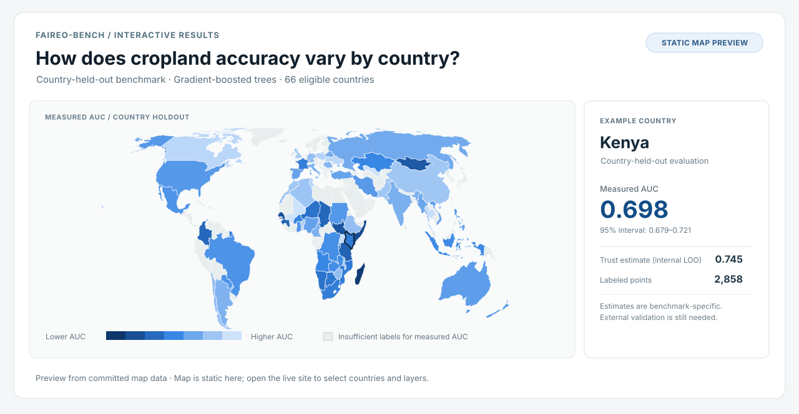
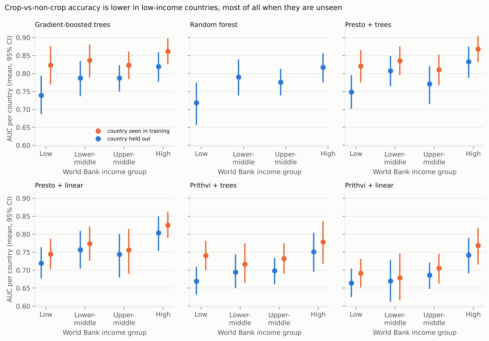
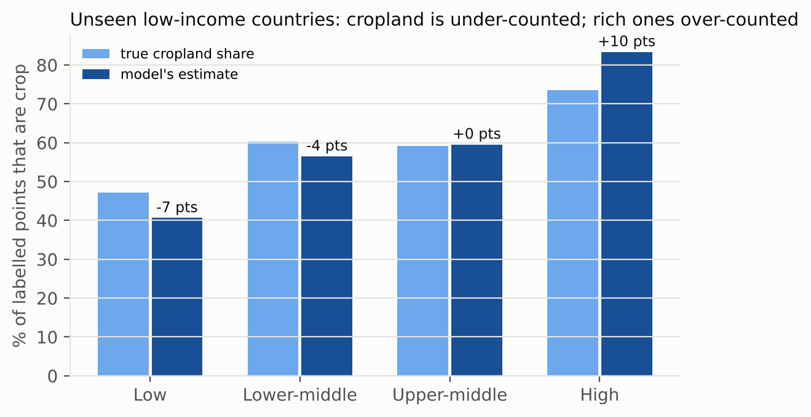
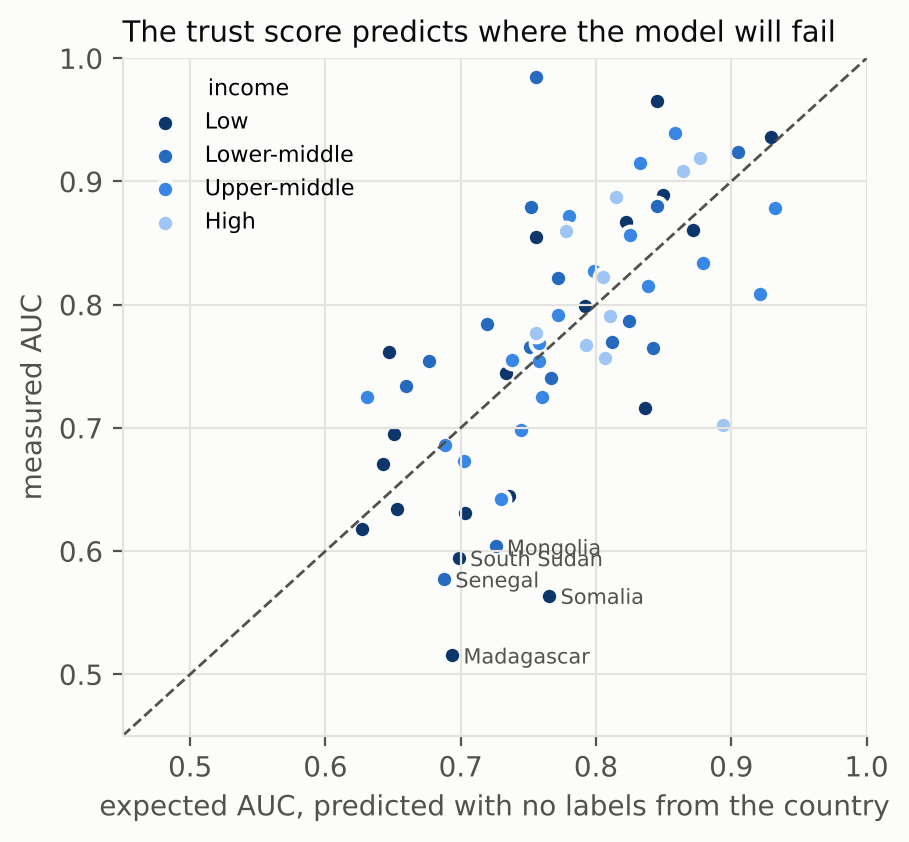
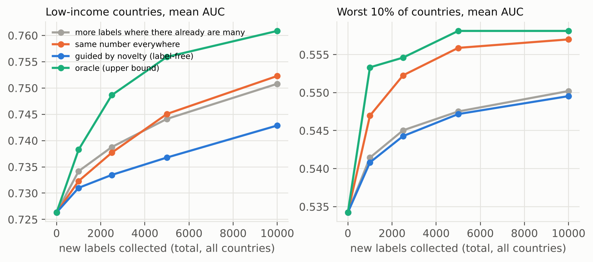

# FairEO-Bench

**How well do cropland classifiers work in countries they have never seen?**

FairEO-Bench evaluates satellite-based crop classification with entire countries
held out of classifier training. The results cover 66 eligible countries in
NASA Harvest's CropHarvest benchmark, along with exploratory work on predicting
country-level reliability and allocating additional labels.

The measurements describe **labeled sample points**, not national cropland area.
Observed differences between income groups do not establish causality.

[Explore the interactive map](https://ashishkesari18.github.io/faireo/docs/trustmap/) ·
[Read the technical note](docs/ARTICLE.md) ·
[Reproduce the experiments](#reproduce)

## Explore the map

[](https://ashishkesari18.github.io/faireo/docs/trustmap/)

*Static preview of the measured-AUC view. [Open the live map](https://ashishkesari18.github.io/faireo/docs/trustmap/) to switch models, inspect country results, and compare reliability estimates with sampled-point crop-prevalence errors.*

---

## Headline results

Data: NASA Harvest's [CropHarvest](https://github.com/nasaharvest/cropharvest)
(87,464 labelled points from 165 countries, each with 12 months of Sentinel-1,
Sentinel-2, ERA5 weather and SRTM terrain). Each country is scored only on a
model that never saw any point from that country (10 folds, grouped by
country). Countries are reported when they have at least 100 points with at
least 20 of each class (66 countries). Intervals are 95% bootstrap intervals
over countries.

| Model | Mean AUC (66 countries) | Low-income | High-income | Gap (95% CI) |
|---|---|---|---|---|
| Gradient-boosted trees | 0.777 | 0.739 | 0.819 | **0.080** (0.007 to 0.149) |
| Random forest | 0.767 | 0.719 | 0.817 | **0.099** (0.023 to 0.172) |
| Presto + trees | 0.782 | 0.748 | 0.833 | **0.085** (0.018 to 0.148) |
| Presto + linear probe | 0.748 | 0.719 | 0.803 | **0.084** (0.017 to 0.152) |
| Prithvi-EO-2.0-tiny + trees † | 0.696 | 0.669 | 0.751 | **0.082** (0.008 to 0.153) |
| Prithvi-EO-2.0-tiny + linear † | 0.684 | 0.664 | 0.742 | **0.078** (0.009 to 0.145) |

† Prithvi is an image model; CropHarvest has one pixel per point, so Prithvi
sees a 16×16 patch filled with that pixel over four seasons (no spatial
texture). This is a pixel adaptation, reported separately for that reason.



**1. The gap changes under country holdout.** When each country's own points are also
in training (random split), the high/low gap for trees falls from 0.080 to
0.039 and its interval includes zero. Low-income countries lose 0.084 AUC from
being unseen; high-income ones lose 0.043.

**2. The gap persists in a common-label-source subset.** Low-income countries get more of their
labels from local field campaigns. Scoring only the Geo-Wiki points, which
were labelled with one protocol worldwide, makes the gap *larger*: 0.16 (0.11
to 0.21) for trees and 0.17 (0.12 to 0.23) for Presto.

**3. Sampled-point prediction prevalence differs by income group.** On unseen low-income countries the trees
model finds 56% of crop points (high-income: 91%). Its predicted crop prevalence among the sampled points comes
out 6.6 percentage points too low in low-income countries and 9.8 points too
high in high-income ones (Presto: −8.3 and +6.3).



**4. A widely used global map shows the same pattern on uniform labels.**
ESA WorldCover 2020/2021, read at all 87,464 points, agrees poorly with
CropHarvest's crop labels everywhere (it finds 42–46% of crop points in every
income group, partly because WorldCover maps many labelled fields as grassland
or shrubland). On Geo-Wiki labels alone, its balanced accuracy is 0.07 lower
in low-income than in high-income countries (0.02 to 0.12), and it finds 24%
of crop points in low-income countries against 34% in high-income ones.

[Full-resolution country AUC figure](docs/figures/02_world_map_auc.png)

## Observed associations with model performance

Regressing per-country AUC (trees, 66 countries) on candidate correlates:

- **Sampled crop prevalence** has the strongest reported bivariate association
  among the tested variables (Spearman ρ = +0.46). Countries with fewer
  crop-labeled observations tended to have lower benchmark AUC. This is
  sample composition, not a national land-area estimate.
- **Distance to the nearest labelled point in another country** matters once
  the other factors are held fixed (−0.045 AUC per standard deviation, p = 0.02).
- **Income on its own** is a weaker predictor (low-income vs the rest: −0.055
  AUC, p = 0.08), and its effect shrinks further (−0.037, p = 0.39) once crop
  share and distance are in the model. These are conditional associations,
  not evidence that specific variables mediate or cause the group gap.
- **Label source** (Geo-Wiki fraction) and sample count were not strong
  predictors in this regression; other labeling differences may remain.

With 66 countries these are associations, not causal estimates. Field size
(smallholder plots) is the obvious next variable to add.

## Tools

### Trust score: how reliable is the model here, with no local labels?

For each country, the trust score combines the model's own confidence on that
country's (unlabelled) imagery with the measured accuracy of the five
countries whose landscapes look most similar in Presto's embedding space. Internally evaluated with leave-one-country-out validation on 66 measured
benchmark countries; independent deployment validation remains open:

- Spearman ρ = **0.72** between trust score and measured AUC (Presto + trees: 0.64)
- mean absolute error 0.061 AUC, against approximately 0.086 for a
  country-mean baseline that excludes each evaluated country

It also produces exploratory estimates for 59 additional countries with too
few labels to meet the country-AUC eligibility threshold. These estimates
are not independently validated deployment guarantees. Similar landscapes predict failure better than nearby countries do:
with the 8 nearest neighbours, landscape neighbours reach ρ = 0.39 against 0.24 for geographic neighbours.



### Sampled-point cropland-prevalence error per country

`results/countries_*.csv` lists, per country, the true and predicted crop
share, recall, calibration error and AUC with intervals. The
[trust map](https://ashishkesari18.github.io/faireo/docs/trustmap/) has a layer for it.

### Where to collect the next labels

`scripts/label_budget.py` measures, for every held-out country, how accuracy
grows when 25, 100 or 400 of its own labels are added to training. It then
splits a fixed budget of new labels across countries under four policies:
more labels where many already exist (the status quo), the same number
everywhere, guided by how unfamiliar each country looks to the model
(label-free), and an oracle upper bound. (Presto + linear probe, 30k-point
training subsample, 3 repeats.)

- **Local labels help, most where the model is weakest.** Averaged over
  countries, retraining with 25, 100 and 400 of a country's own labels raises
  its AUC by 0.010, 0.022 and 0.045. With 400 labels, low-income countries gain
  0.056 against 0.023 for high-income ones.
- **Spreading labels evenly beats the status quo.** With 10,000 new labels,
  status-quo allocation lifts mean AUC from 0.752 to 0.772; the same number
  spread evenly reaches 0.776 and does more for the worst 10% of countries (0.557 vs 0.550).
- **The label-free guide does not beat "spread evenly" yet** (0.771). The
  oracle shows the headroom: 0.781 overall and 0.761 in low-income countries
  (status quo 0.751). Closing that gap with a better label-free targeting rule
  is open work.



## Fixes tested

All evaluated on countries held out of training.

| Fix | Uses local labels? | Effect |
|---|---|---|
| Balanced training (every country weighted equally, power 0.5) | No | Balanced accuracy up overall (trees 0.673 → 0.690, Presto 0.674 → 0.699) and in low-income countries (0.659 → 0.668, 0.652 → 0.681); AUC and the AUC gap unchanged |
| Recalibration on the 8 most similar countries | No | No reliable gain; slightly lowers mean balanced accuracy |
| Prior-shift EM (Saerens et al., 2002) | No | Harmful here: the models are not calibrated enough on unseen countries for EM to work |
| Recalibrate with 20 local labels | 20 per country | Mean absolute cropland-share error 9.4 → 7.6 points; low-income under-count −6.6 → −3.6 points |
| Retrain with 25–400 local labels | Yes | See label-budget section |

The negative results are part of the finding. These experiments do not
identify a causal mechanism for the observed group gap. In this benchmark,
some tested local-label strategies help; a simulated allocation experiment
favors spreading new labels evenly under its stated assumptions.

## Reproduce

The scripts are designed for laptop CPU execution without paid APIs.
An independent end-to-end reproduction is still needed.

```bash
git clone https://github.com/ashishkesari18/faireo && cd faireo
pip install -r requirements.txt
bash run_all.sh            # downloads ~170 MB, about 2-3 hours end to end
python tests/test_core.py  # fast checks, no data needed
```

| Step | Script |
|---|---|
| Download CropHarvest and borders | `scripts/download.sh` |
| One table with country, continent and income | `scripts/prepare.py` |
| Data-quality table | `scripts/quality.py` |
| Presto / Prithvi embeddings | `scripts/embed_presto.py`, `scripts/embed_prithvi.py` |
| Out-of-fold predictions | `scripts/audit.py --model M --split country|random [--balance 0.5]` |
| Per-country metrics and gaps | `scripts/report.py` |
| Label-source control | `scripts/label_control.py` |
| ESA WorldCover audit | `scripts/sample_worldcover.py`, `scripts/worldcover_audit.py` |
| Explanation and trust score | `scripts/novelty.py`, `scripts/explain.py`, `scripts/trust.py` |
| Fixes | `scripts/recalibrate.py` |
| Label budget | `scripts/label_budget.py` |
| Figures and map | `scripts/figures.py`, `scripts/build_trustmap.py` |

## Research process and validation

- [Continent-held-out reliability stress test (exploratory)](docs/GEOGRAPHIC_STRESS_TEST.md)
- [Research log: executed checks and open work](docs/RESEARCH_LOG.md)
- [Methods and validity boundaries](docs/METHODS_AND_LIMITATIONS.md)
- [Sensitivity-experiment protocol](docs/EXPERIMENT_PROTOCOL.md)
- [Saved sensitivity results](results/validation/gap_sensitivity_lgbm_country_s0.json)

The legacy `area_err_pp` metric in exported CSVs is **sampled-point crop
prevalence error**, computed as `100 * (pred_prevalence - prevalence)`. The
name is retained for compatibility, but it is not an area-weighted estimate.
Run `python tests/test_review_pack.py` to test the new analysis functions.
Run `python scripts/verify_country_results.py` for CSV arithmetic consistency,
`python scripts/sensitivity_gap.py` for country-level sensitivity, and
`python scripts/geographic_stress_test.py` for the continent-blocked
country-level reliability analysis. These checks are not an independent
end-to-end reconstruction of the satellite model training pipeline.

## Limitations

- Labels are points, not fields, and come from 27 campaigns of different
  years (2016–2021). The Geo-Wiki-only check controls for the source, not for
  label noise that may itself be higher on small fields.
- Income groups are the World Bank classes recorded in Natural Earth, which
  are a few years old.
- 66 countries give wide intervals; the direction is consistent across all
  six models, but individual country numbers are uncertain (see the per-country CIs).
- Prithvi is used without spatial context (see above). A fair image-based
  comparison needs HLS image chips, which is planned next.
- WorldCover's class definitions differ from CropHarvest's "crop" label, so its
  absolute numbers mostly reflect definitions. The between-group difference is
  the meaningful part.

## Credits

CropHarvest: Tseng, Zvonkov, Nakalembe and Kerner, *NeurIPS Datasets and
Benchmarks* 2021. Presto: Tseng et al., 2023 (MIT licence, weights vendored in
`weights/presto.pt`). Prithvi-EO-2.0: Szwarcman et al., 2024 (Apache 2.0, weights
downloaded from Hugging Face on first use). ESA WorldCover © ESA 2021, CC BY 4.0.
Natural Earth borders, public domain.

MIT licence. Author: Ashish Kesari.
